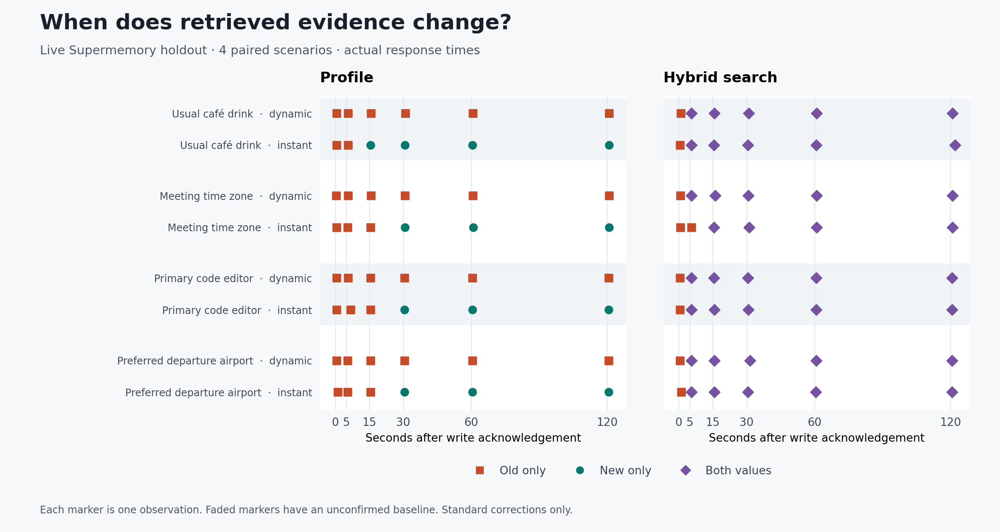

# What changed in the four-fact holdout

The shipping-city result repeated across four new fact types: café order, meeting time zone, code editor, and departure airport. The study completed all 24 arms across 12 scenarios with 56 writes, 552 reads, and zero API errors.

At the 30- and 120-second checkpoints in the four standard corrections, instant profiles returned the new value alone for 4/4 facts. Dynamic profiles still returned the old value alone for 4/4. These are observations within the study window. The experiment did not observe when dynamic profiles converged after the last checkpoint.

Hybrid search returned both values under both modes in all four standard corrections. At 120 seconds, the extracted memories contained the new value alone under instant processing and the old value alone under dynamic processing for 4/4 facts. Source chunks contained both values under both modes. This distinction matters for a current-state question: the answer model can receive an older source alongside a corrected fact.

The late code-editor case illustrates a limit of the lexical classifier. The instant profile said, “Devon’s primary code editor is Zed instead of Neovim.” The classifier counts both mentions, even though the sentence clearly resolves the correction. The strict late-regression denominator therefore includes only three instant profiles. All three retained the new value without an old-value mention during the late-import window. All four unchanged controls retained their original value under both modes.

The facts and histories are synthetic. The provider responses and timings are live. The study measures returned evidence across four facts using a shared fixture structure. Agent answer accuracy was outside this run.



- [Study protocol](../../docs/holdout-protocol.md)
- [Primary tables](holdout-findings.md)
- [Timeline chart](evidence-timeline.png)
- [Published observations](observations.ndjson)

## Reproduce the analysis

The checked-in journal preserves the synthetic evidence text, observations, and hybrid source fields. Private namespace and document IDs and unrelated response metadata were removed from this export.

Run from the repository root. These commands read local files.

```sh
node --experimental-strip-types scripts/holdout-report.ts results/four-fact-holdout
node --experimental-strip-types src/cli.ts report --run results/four-fact-holdout
python scripts/plot_capture.py results/four-fact-holdout --cohort
```
